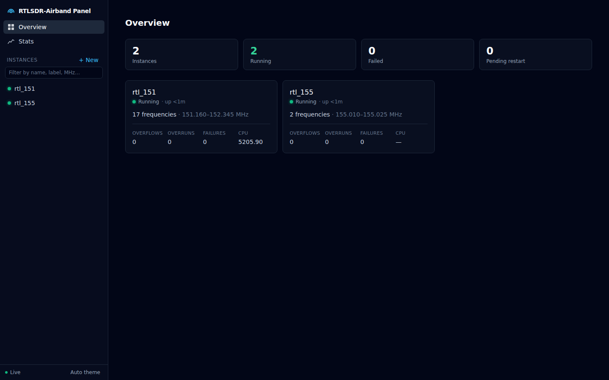
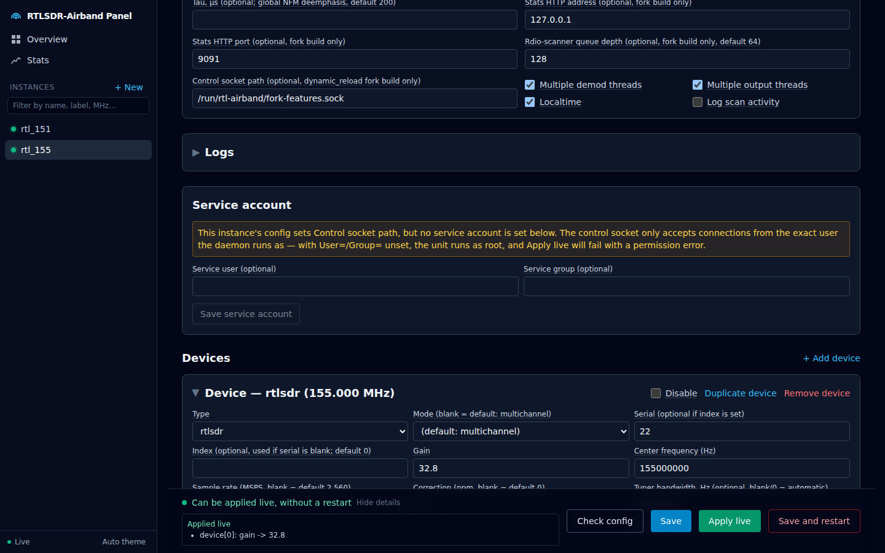
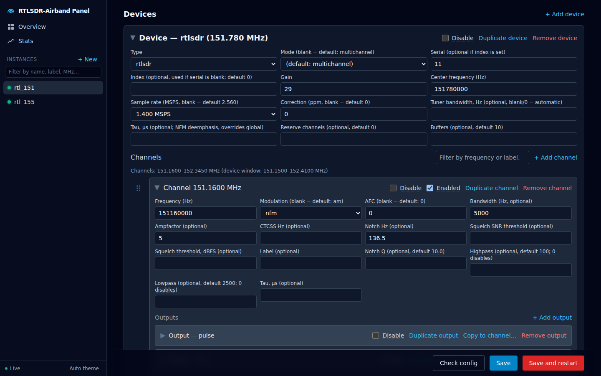
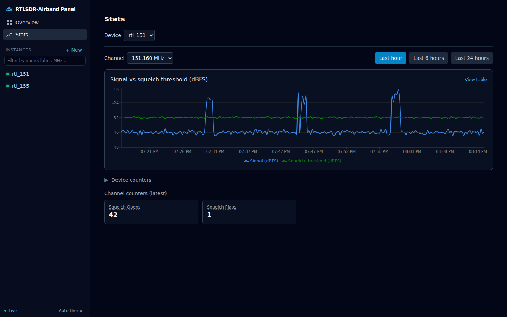

# rtl-airband-panel

[](https://github.com/jschmall/rtl-airband-panel/actions/workflows/ci.yml)
[](./LICENSE)

A web control panel for [RTLSDR-Airband](https://github.com/rtl-airband/RTLSDR-Airband).

If you run more than one SDR with RTLSDR-Airband, each one is its own
`rtl_airband` process with its own `.conf` file and systemd service. This
panel gives you one place to see them all, edit their configs safely, and
restart only the one you changed.



## What it does

- **See everything at a glance.** Every instance with a status light
  (running, starting, failed, stopped), uptime, the frequencies it covers,
  and any problem counters such as buffer overflows or failed uploads.
- **Edit configs in a form, not a text file.** Devices, channels, mixers and
  every output type (Icecast, file, UDP, PulseAudio, rdio-scanner uploads,
  and more), with drag-and-drop channel ordering and duplicate/copy buttons.
- **Catch mistakes before they reach the radio.** Errors show up as you
  type: frequencies outside the dongle's range, two channels landing in the
  same FFT bin, unsupported sample rates, CTCSS typos, and many more. A
  config with errors can't be saved.
- **Know what a change will do before you make it.** The editor tells you
  whether a change can be applied to the running instance on the fly, or
  needs a restart, and which channels would briefly drop out.
- **Apply changes without a restart** where the radio supports it: retune,
  gain, sample rate, adding or editing channels, and turning channels on or
  off. Needs the RTLSDR-Airband fork, see
  [Live apply](#applying-changes-without-a-restart).
- **Restart only what you changed.** Saving one instance never touches the
  others. Instances with saved changes that aren't running yet are flagged,
  with one click to restart them all.
- **Check each radio's health live.** A Hardware page per SDR: headroom
  before the ADC clips, noise floor, how far off-frequency the dongle is
  (with a suggested `correction`), gain (with a suggested setting), and
  dropped samples. Needs the
  RTLSDR-Airband fork, see [Hardware](#using-the-panel).
- **Watch logs and history.** A live log viewer per instance, plus charts
  of signal versus squelch level per channel, and a Prometheus `/metrics`
  endpoint.
- **Nothing is lost on save.** Every save keeps a backup of the previous
  file, settings the panel doesn't know about are kept exactly as written,
  and passwords are hidden unless you ask to see them.
- **Works from your phone.** The layout adapts to small screens. There's
  a dark and a light theme.

## Which RTLSDR-Airband do I need?

The release download includes a build of
[`jschmall/RTLSDR-Airband`](https://github.com/jschmall/RTLSDR-Airband), a
fork that tracks upstream and adds:

- applying changes without a restart (the control socket)
- rdio-scanner call uploads
- combining channels from different SDRs into one mix (`mixer_remote`)
- structured JSON logs, and a stats HTTP endpoint
- live hardware health readings (headroom, frequency error) for the
  Hardware page

New instances you create in the panel use that build. Instances you
already have keep running whatever `rtl_airband` their service points at,
so you can switch them over one at a time, or not at all.

The panel also works with standard RTLSDR-Airband. The editor marks
fork-only settings as such. Standard RTLSDR-Airband ignores most of them,
but a few (the `mixer_remote` output type, JSON logging) stop it from
starting.

The bundled `rtl_airband` supports RTL-SDR and Mirics dongles, with
narrowband FM and rdio-scanner uploads. It's built without PulseAudio and
SoapySDR output/input; if you need those, build the fork yourself and point
the panel at it (`RTL_PANEL_RTL_AIRBAND_BIN`).

## Installing

### From a release (recommended)

Releases are on the
[Releases page](https://github.com/jschmall/rtl-airband-panel/releases),
for 64-bit Intel/AMD (`amd64`) and 64-bit ARM (`arm64`: a Raspberry Pi 3,
4 or 5 running a 64-bit OS). Both programs are self-contained, so they
work on any Linux with systemd: Debian, Ubuntu, Raspberry Pi OS and others.

```bash
# pick the file for your machine (uname -m: x86_64 = amd64, aarch64 = arm64)
curl -LO https://github.com/jschmall/rtl-airband-panel/releases/download/vX.Y.Z/rtl-airband-panel-vX.Y.Z-linux-amd64.tar.gz
tar xzf rtl-airband-panel-vX.Y.Z-linux-amd64.tar.gz
cd rtl-airband-panel-vX.Y.Z-linux-amd64
sudo ./install.sh
```

The installer sets up:

- the panel and the bundled `rtl_airband`, in
  `/usr/local/lib/rtl-airband-panel/` (linked from `/usr/local/bin`; an
  `rtl_airband` you already have there is left alone);
- an `rtl-airband-panel` account that runs the panel and new instances;
- access to SDR dongles without root (a udev rule, and a blacklist that
  stops the kernel's TV drivers from grabbing them; if they're already
  loaded, reboot once);
- the panel's settings in `/etc/rtl-airband-panel/panel.env`;
- a narrow `sudo` rule so the panel can start, stop and restart instance
  services;
- the panel's own service, started now and at every boot.

Then open <http://localhost:3000> on that machine. Useful options (see
`./install.sh --help`):

| Option | |
| --- | --- |
| `--listen-all` | Reachable from your whole network; generates a login password and prints it |
| `--instances-dir DIR` | Where your instance configs live (default `/etc/rtl-airband-panel/instances`) |
| `--unit-prefix rtl_` | Only let the panel manage services whose names start with `rtl_` |
| `--no-start` | Install but don't start the panel yet |

**Upgrading:** download the new release and run `sudo ./install.sh` again.
It replaces both programs and keeps your settings. Running instances keep
the old `rtl_airband` until each one is restarted.

**Uninstalling:** `sudo ./install.sh --uninstall` removes the programs, the
panel's service and its system files. It keeps your configs, settings,
stats and every instance's own service.

**Already running the old Node.js panel?** The installer backs up its
service file and replaces it; see
[Migrating from the Node.js panel](./DEPLOYMENT.md#migrating-from-the-nodejs-panel).

### Building from source

Building takes a few minutes on a PC. A Raspberry Pi can build it too, but
slowly (think tens of minutes on a Pi 4, with at least 2 GB of RAM). This
builds only the panel; `rtl_airband` comes from your own install.

**1. Install the build tools.** On Debian, Ubuntu or Raspberry Pi OS:

```bash
sudo apt install build-essential git
curl --proto '=https' --tlsv1.2 -sSf https://sh.rustup.rs | sh   # Rust
```

You also need Node.js 20 or newer (check with `node --version`). It's
only used during the build; the panel itself doesn't need it.

**2. Build:**

```bash
git clone https://github.com/jschmall/rtl-airband-panel.git
cd rtl-airband-panel
npm ci
npm run build --workspace=frontend
cargo build --release -p rtl-airband-panel
```

**3. Install the program:**

```bash
sudo install -m 0755 target/release/rtl-airband-panel /usr/local/bin/
rtl-airband-panel --version
```

That's one file with everything built in. To run it as a service, follow
[DEPLOYMENT.md](./DEPLOYMENT.md). To build the full release tarball
(including `rtl_airband`) yourself, see
[DEVELOPMENT.md](./DEVELOPMENT.md#releases).

## Trying it out

The installer's panel manages real services straight away. To look around
first without any risk (or after building from source), run the panel by
hand against a **copy** of your configs, so nothing you try can affect your
running radios (add `--port 3001` if the installed panel is already using
3000):

```bash
mkdir -p ~/panel-test
cp /path/to/your/configs/*.conf ~/panel-test/
rtl-airband-panel --instances-dir ~/panel-test
```

Then open <http://localhost:3000>. If the panel runs on a different machine,
connect with `ssh -L 3000:localhost:3000 you@that-machine` and open the
same address on your own computer.

Out of the box the panel is in **safe mode**: it never starts, stops or
restarts anything, so statuses read "Unknown". Saving does write to the
config files in the folder you pointed it at, which is why you're using a
copy.

When you're ready to manage your real instances (start the panel at boot,
reach it from other devices, let it restart services), follow
[DEPLOYMENT.md](./DEPLOYMENT.md).

## Using the panel

**Instances.** Each instance is one config file, `<name>.conf`, managed by a
systemd service of the same name, `<name>.service`. Pick any names you like.
The left-hand list shows every instance with its status light. Type in the
filter box to find an instance by name, channel label, frequency or
modulation. **+ New** creates an instance (config file and service).
Rename, restart and delete are at the top of each instance's page.

**Editing and saving.** Open an instance, change what you need, and use the
bar at the bottom of the page:

- **Save** writes the config. The running instance keeps its old settings
  until it's restarted, and the instance is marked *pending restart*.
- **Apply live** saves, then asks the running instance to pick up whatever
  it can without restarting (see the next section).
- **Save and restart** saves and restarts that instance. Its audio drops
  for a few seconds.
- **Check config** runs the full check without saving.

As you edit, the bar shows which of these your change needs: "Can be
applied live", "Needs a restart", or "already running". Click **Details** to
see exactly what changes and which channels would briefly drop out. Errors
appear at the top of the page and in the bar; click one to jump to the
field. `Ctrl+S` saves.

**Pending restarts.** A yellow banner lists instances whose saved config
isn't running yet, with a button to restart them all.

**Passwords.** Icecast passwords and rdio-scanner API keys show as dots.
Leave them alone and they're kept as they are; click **Show** to reveal one.

**Logs.** Each instance's page has a live log viewer. Turn on JSON logging
there (fork only) for cleaner, structured log lines; this restarts the
instance.

**Stats.** The Stats page charts each channel's signal against its squelch
level over the last hour, 6 hours or day, plus device and output counters.
For this, an instance needs `stats_filepath` set in its config. History is
kept for 7 days by default.

**Hardware.** The Hardware page shows every SDR, sorted by serial number,
live, updating every second:
- **Headroom**: how far the strongest signal sits below the point where
  the dongle's ADC clips. Under 3 dB is marked low and under 1 dB is
  clipping, which smears strong signals across the band.
  - **Suggested gain:** the page puts the strongest peak from the last
    5 minutes about 6 dB below clipping.
  - **Lowering:** when peaks come within 3 dB of clipping, or samples
    clip, it says to lower the gain, and names a gain step the tuner
    supports.
  - **Raising:** it says gain can go up only after 2 minutes in which no
    peak came within 12 dB of clipping.
- **Noise floor**: the median across the SDR's channels.
- **Frequency error**: how far received carriers sit from their configured
  frequencies, in ppm. All channels on one dongle share its oscillator, so
  this is the dongle's drift, and the page suggests the `correction` that
  would cancel it. The suggestion is the value to set, not an amount to
  add. Set it and restart the instance; once the error is under 0.75 ppm
  the page says "Correction OK". It needs a few transmissions before it
  shows anything.
- **Dropped and clipped samples**: running totals and per-second rates.
- **Settings**: center frequency, span, gain and correction.
- **Channels**: a per-channel table of signal, noise and frequency offset.

Live readings need an instance running the bundled fork (v6.4.0 or later)
with `control_socket_path` set. Other instances show their configured
values and say why they aren't live.

**Themes.** The bottom of the left-hand list switches between automatic
(follows your system), dark and light.

## Applying changes without a restart

This needs the [fork](#which-rtlsdr-airband-do-i-need). To turn it on for an
instance:

1. Set **Control socket path** in the instance's config to a path unique to
   that instance, for example `/run/rtl-airband/<name>.sock`, and restart it
   once.
2. Make the instance run as the same user as the panel: set **Service
   account** on its page, or set `RTL_PANEL_DEFAULT_SERVICE_USER` for every
   instance (see [Settings](#settings)). The panel warns you if this is
   missing; without it, Apply live fails with a permission error.

**What can change without a restart:**

- center frequency (a retune)
- sample rate on RTL-SDR and Mirics dongles (the whole dongle pauses
  briefly)
- gain and tuner bandwidth on RTL-SDR and SoapySDR devices
- frequency correction (PPM) on RTL-SDR dongles
- switching channels and mixers on or off (the **Enabled** checkbox)
- adding, editing and removing channels, as long as the device has spare
  capacity: set **Reserve channels** on the device (and **Reserve inputs**
  on any mixer those channels feed), then restart once. Editing a channel
  briefly drops it and the channels listed after it.

**What always needs a restart:** global settings, a mixer's own outputs
and filters, device serial numbers or buffers, and adding or removing a
device or mixer. You don't need to remember this list: the bar at the
bottom of the editor tells you before you save.

After Apply live, the panel shows what was applied, what still needs a
restart, and anything that didn't take but can simply be retried, for
example after a brief hardware hiccup. A failed live change never stops the
instance; it keeps running with its previous settings.

## Combining channels from different SDRs

With the fork, a mixer in one instance can take audio from a channel in
another instance on the same machine. This is useful for building one mixed
stream out of several dongles. On the sending channel, add an output of type
**mixer_remote**. On the receiving mixer, add a **Remote input** with the
same path and stream ID:

```
# sending instance, on a channel:
outputs: ( { type = "mixer_remote"; dest_path = "/run/rtl-airband/mymix.sock"; stream_id = 0; } );

# receiving instance:
mixers: { mymix: {
  remote_inputs: ( { listen_path = "/run/rtl-airband/mymix.sock"; stream_id = 0; label = "site 2"; } );
  outputs: ( /* ... */ );
}; };
```

Both instances must run as the same user. Several senders can share one
path as long as each has its own stream ID. Remote inputs only connect when
the receiving instance starts, so changing them always needs a restart.

## Settings

Settings can be given as command-line options
(`rtl-airband-panel --port 8080`), environment variables
(`RTL_PANEL_PORT=8080`), or a settings file: a `.env` file in the current
folder, `--env-file <path>`, or the `panel.env` file when running as a
service ([DEPLOYMENT.md](./DEPLOYMENT.md)). If a setting appears more than
once, the command line wins, then the environment, then the file. See
[`.env.example`](.env.example) for a template, and `rtl-airband-panel --help`
for the full list.

| Setting | Option | Default | What it does |
|---|---|---|---|
| `RTL_PANEL_INSTANCES_DIR` | `--instances-dir` | `/etc/rtl-airband-panel/instances` | Folder holding the `<name>.conf` files. The panel keeps its own bookkeeping files here too (names starting with `.`); leave those alone |
| `RTL_PANEL_SYSTEMD_MODE` | `--systemd-mode` | `mock` | `mock` never touches systemd (safe mode); `sudo` really starts, stops and restarts services. See [DEPLOYMENT.md](./DEPLOYMENT.md#allowing-real-systemd-control-sudo-mode) |
| `RTL_PANEL_SUDO_UNIT_PREFIX` | `--sudo-unit-prefix` | empty | Only manage services whose names start with this, e.g. `rtl_`. Recommended if your instance names share a prefix |
| `RTL_PANEL_RTL_AIRBAND_BIN` | `--rtl-airband-bin` | `/usr/local/bin/rtl_airband` | The `rtl_airband` program new instances run |
| `RTL_PANEL_UNIT_DIR` | `--unit-dir` | `/etc/systemd/system` | Where service files for new instances are written |
| `RTL_PANEL_DEFAULT_SERVICE_USER` / `_GROUP` | `--default-service-user` / `--default-service-group` | empty | User and group instances run as, unless set on the instance's page. Set to the panel's own user for [live apply](#applying-changes-without-a-restart) |
| `RTL_PANEL_HOST` | `--host` | `127.0.0.1` | Network address to listen on. The default is this machine only; `0.0.0.0` means every network |
| `RTL_PANEL_PORT` | `--port` | `3000` | Port to listen on |
| `RTL_PANEL_PASSWORD` | `--password` | none | Login password. Required when the panel is reachable from other machines |
| `RTL_PANEL_USERNAME` | `--username` | `admin` | Login username |
| `RTL_PANEL_ALLOWED_HOSTS` | `--allowed-hosts` | none | Address(es) people use to reach the panel through a reverse proxy, e.g. `panel.example.com`. See [DEPLOYMENT.md](./DEPLOYMENT.md#running-behind-a-reverse-proxy) |
| `RTL_PANEL_ALLOW_UNAUTHENTICATED` | `--allow-unauthenticated` | `false` | Allow access from other machines without a password. Anyone who can reach the panel can then change your configs |
| `RTL_PANEL_STATS_DB_PATH` | `--stats-db-path` | `~/.rtl-airband-panel/stats.db` | Where stats history is stored |
| `RTL_PANEL_STATS_RETENTION_DAYS` | `--stats-retention-days` | `7` | How many days of stats history to keep; `0` keeps everything |
| `RTL_PANEL_STATS_POLL_INTERVAL_MS` | `--stats-poll-interval-ms` | `15000` | How often stats are collected, in milliseconds |
| `RTL_PANEL_STATS_PRUNE_INTERVAL_MS` | `--stats-prune-interval-ms` | `3600000` | How often old stats are cleaned up, in milliseconds |
| `RTL_PANEL_CONTROL_SOCKET_TIMEOUT_MS` | `--control-socket-timeout-ms` | `8000` | How long Apply live waits for an answer, in milliseconds |
| `RTL_PANEL_HARDWARE_POLL_INTERVAL_MS` | `--hardware-poll-interval-ms` | `1000` | How often the Hardware page's live readings refresh while someone has it open, in milliseconds |
| `RTL_PANEL_LOG_LEVEL` | `--log-level` | `info` | How much the panel logs: `error`, `warn`, `info`, `debug` |
| `RTL_PANEL_LOG_FILE` | `--log-file` | none | Write the panel's log to this file instead of the system journal |

## Backups and moving to a new machine

- **Every save keeps the previous version** of that instance's config in
  `.backups/<name>/` inside the instances folder (the last 10 per instance).
- **Export and import** every instance's config (including passwords) from
  the command line:

  ```bash
  curl -u admin:yourpassword http://localhost:3000/api/instances/export > instances.json
  curl -u admin:yourpassword -H 'content-type: application/json' \
       --data @instances.json http://localhost:3000/api/instances/import
  ```

  Import creates the instances that don't exist yet and skips those that
  do. Leave out `-u ...` if the panel has no password.
- **Stats history** (`stats.db`) can be thrown away at any time; the panel
  starts a new one.

## Troubleshooting

**Statuses all say "Unknown".** The panel is in safe mode
(`RTL_PANEL_SYSTEMD_MODE=mock`). That's expected when trying it out; see
[DEPLOYMENT.md](./DEPLOYMENT.md) to let it control your services.

**"Refusing to listen on 0.0.0.0 without authentication".** Set
`RTL_PANEL_PASSWORD` when the panel is reachable from other machines.

**Apply live says "permission denied" or "unreachable".** The instance must
run as the same user as the panel (see
[Applying changes without a restart](#applying-changes-without-a-restart)),
have a control socket path, and have been restarted since that path was
set.

**Status checks or restarts fail with a sudo error.** Install or update the
sudoers rule ([DEPLOYMENT.md](./DEPLOYMENT.md#allowing-real-systemd-control-sudo-mode)).
Rules from older versions of the panel are missing a permission the current
one needs.

**"Host not allowed" behind a reverse proxy.** Add the address you use to
`RTL_PANEL_ALLOWED_HOSTS` and pass the `Host` header through
([DEPLOYMENT.md](./DEPLOYMENT.md#running-behind-a-reverse-proxy)).

**My comments disappeared from a config file.** The panel rewrites the whole
file on every save and doesn't keep comments. The previous version, with
comments, is in `.backups/<name>/`.

**The Stats page is empty.** The instance needs `stats_filepath` set, and
needs to be running for a few minutes to collect history.

**The Hardware page says "Not live".** The reason is shown next to the
instance name. Usually the instance either has no `control_socket_path`
or runs an `rtl_airband` older than fork v6.4.0. The control socket also
only accepts connections from the same user, so the instance's service
must run as the panel's user.

**Something else.** Check the panel's log with
`journalctl -u rtl-airband-panel`, and include `rtl-airband-panel --version`
when you report a problem.

## More screenshots

Editing an instance. The bar at the bottom says this change can be applied
live:



A channel's settings and outputs:



Signal versus squelch level for one channel:



## More documentation

- [DEPLOYMENT.md](./DEPLOYMENT.md): running the panel as a service,
  reaching it from other devices, passwords, reverse proxies, letting it
  control systemd, and upgrading from the older Node.js version.
- [DEVELOPMENT.md](./DEVELOPMENT.md): how the panel works inside, building
  and testing, and the project's architecture.
- [CONTRIBUTING.md](./CONTRIBUTING.md): how to propose a change.
- [CHANGELOG.md](./CHANGELOG.md): what changed in each version.

## License

[GPL-2.0](./LICENSE).
