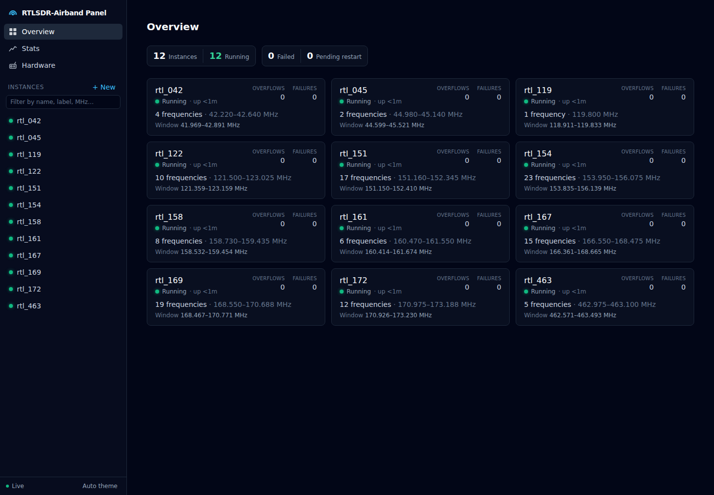
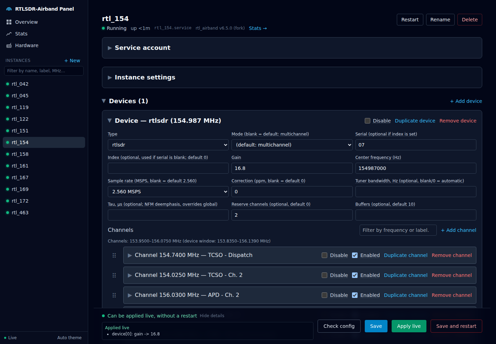
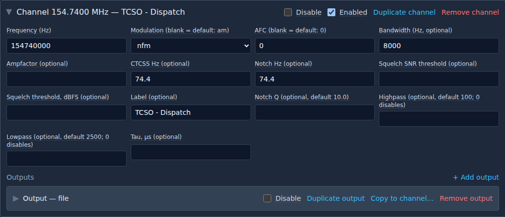
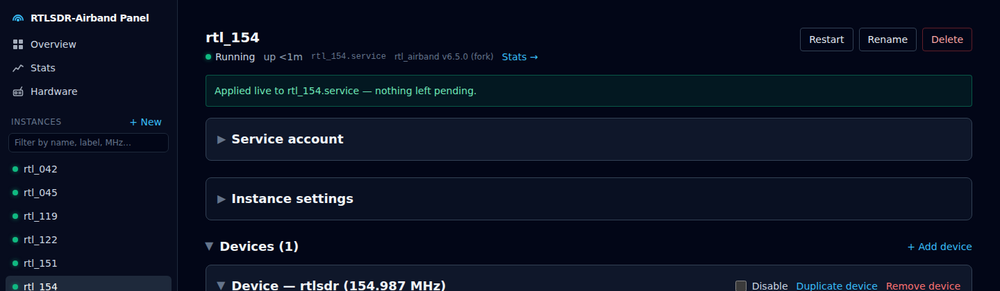
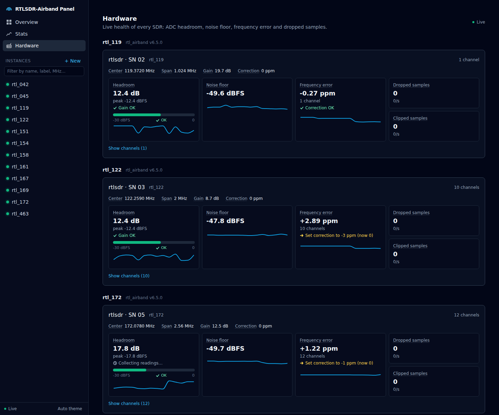
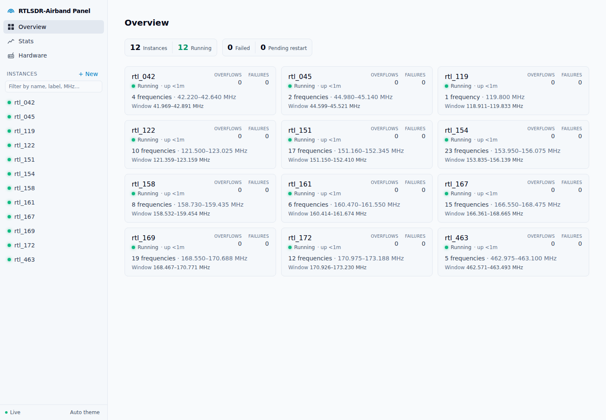
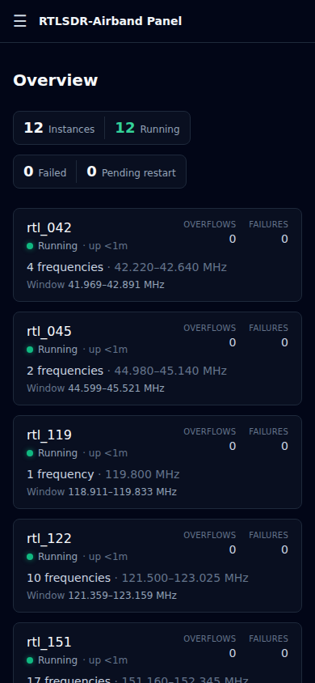

# User guide

How to use each part of rtl-airband-panel once it's installed. To install
it, see the [README](../README.md#installing). To run it as a service,
reach it from other devices or let it control systemd, see
[DEPLOYMENT.md](../DEPLOYMENT.md).

- [Instances](#instances)
- [Editing and saving](#editing-and-saving)
- [Applying changes without a restart](#applying-changes-without-a-restart)
- [Hardware](#hardware)
- [Stats](#stats)
- [Logs](#logs)
- [Themes and phones](#themes-and-phones)
- [Stock rtl_airband](#stock-rtl_airband)
- [Combining channels from different SDRs](#combining-channels-from-different-sdrs)
- [Settings](#settings)
- [Backups and moving to a new machine](#backups-and-moving-to-a-new-machine)
- [Troubleshooting](#troubleshooting)

## Instances

Each instance is one config file, `<name>.conf`, managed by a systemd
service of the same name, `<name>.service`. Pick any names you like.



- **Overview** shows every instance as a card:
  - its status (running, starting, failed, stopped) and uptime;
  - buffer overflows and output failures, in the top right;
  - the frequencies it listens on;
  - each SDR's **window**: the range around its center frequency where
    channels can go. A new channel inside the window fits on that dongle
    without retuning it.

  The tiles at the top count instances that are running, failed, or have
  saved changes waiting for a restart.
- **The left-hand list** shows every instance with its status light. Type
  in the filter box to find an instance by name, channel label, frequency
  or modulation.
- **+ New** creates an instance (config file and service). Rename, restart
  and delete are at the top of each instance's page.

## Editing and saving



An instance's page has five sections: **Service account**, **Instance
settings**, **Devices**, **Mixers** and **Logs**. Each one collapses, and
each device and mixer inside them does too. The page remembers which are
open separately for every instance, in your browser.

Change what you need, then use the bar at the bottom of the page:

- **Save** writes the config. The running instance keeps its old settings
  until it's restarted, and it's marked *pending restart*.
- **Apply live** saves, then asks the running instance to pick up whatever
  it can without restarting. See the
  [next section](#applying-changes-without-a-restart).
- **Save and restart** saves and restarts that instance. Its audio drops
  for a few seconds.
- **Check config** runs the full check without saving.

As you edit, the bar says which of these your change needs: "Can be
applied live", "Needs a restart", or "already running". **Details** lists
exactly what changes, and which channels would briefly drop out.

**Mistakes are caught as you type.** Errors appear at the top of the page
and in the bar, and a config with errors can't be saved. Click an error to
jump to its field. The panel checks, among other things:
- channels outside the dongle's window;
- two channels landing in the same FFT bin;
- unsupported sample rates and CTCSS tones;
- decimals in settings rtl_airband only reads as whole numbers. A decimal
  in a Hz field would be read as MHz.

`Ctrl+S` saves.



**Channels and outputs.** Every output type is a form: Icecast, file,
UDP, PulseAudio, rdio-scanner uploads, mixers. Drag channels to reorder
them. Duplicate copies a channel, output, device or mixer.

**Pending restarts.** A yellow banner lists instances whose saved config
isn't running yet, with a button to restart them all.

**Passwords.** Icecast passwords and rdio-scanner API keys show as dots.
Leave them alone and they're kept as they are; click **Show** to reveal
one.

## Applying changes without a restart

This needs the [fork](../README.md#which-rtlsdr-airband-do-i-need). To turn
it on for an instance:

1. Set **Control socket path** in the instance's settings to a path unique
   to that instance, for example `/run/rtl-airband/<name>.sock`, and
   restart it once.
2. Make the instance run as the same user as the panel: set **Service
   account** on its page, or set `RTL_PANEL_DEFAULT_SERVICE_USER` for every
   instance (see [Settings](#settings)). The panel warns you if this is
   missing; without it, Apply live fails with a permission error.



**What can change without a restart:**

- center frequency (a retune)
- sample rate on RTL-SDR and Mirics dongles (the whole dongle pauses
  briefly)
- gain and tuner bandwidth on RTL-SDR and SoapySDR devices
- frequency correction (PPM) on RTL-SDR dongles
- switching channels and mixers on or off (the **Enabled** checkbox)
- adding, editing and removing channels, as long as the device has spare
  capacity: set **Reserve channels** on the device (and **Reserve inputs**
  on any mixer those channels feed), then restart once. Editing a channel
  briefly drops it and the channels listed after it.

**What always needs a restart:** global settings, a mixer's own outputs
and filters, device serial numbers or buffers, and adding or removing a
device or mixer. You don't need to remember this list: the bar at the
bottom of the editor tells you before you save.

After Apply live, the panel shows what was applied, what still needs a
restart, and anything that didn't take but can simply be retried, for
example after a brief hardware hiccup. A failed live change never stops
the instance; it keeps running with its previous settings.

## Hardware



The Hardware page shows every SDR, sorted by serial number, updating every
second. Click an instance's name to open it, or an SDR's title to open its
device settings.

- **Headroom**: how far the strongest signal sits below the point where
  the dongle's ADC clips. Under 3 dB is marked low, and under 1 dB is
  clipping, which smears strong signals across the band.
- **Gain advice**, under the headroom, looks at the last 5 minutes at the
  current gain and aims to put the strongest peak about 6 dB below
  clipping:
  - **Lower gain** (amber) when peaks come within 3 dB of clipping;
  - **Room to raise gain** (blue) when no peak came within 12 dB;
  - suggested gains are steps the tuner supports.

  Before giving advice it waits for 2 minutes of readings and says
  "Collecting readings…", except when samples are clipping right now.
  The panel records readings in the background, even with the page
  closed, so opening it usually gives advice straight away.
- **Noise floor**: the median across the SDR's channels.
- **Frequency error**: how far received carriers sit from their configured
  frequencies, in ppm. All channels on one dongle share its oscillator, so
  this is the dongle's drift, and the page suggests the `correction` that
  would cancel it.
  - **The suggestion is the value to set,** not an amount to add. Set it
    and restart the instance.
  - **"Correction OK"** appears once the error is under 0.75 ppm.
  - **It needs transmissions:** nothing shows until a few have been heard.
- **Dropped and clipped samples**: running totals and per-second rates.
- **Settings**: center frequency, span, gain and correction.
- **Channels**: a per-channel table of signal, noise and frequency offset.

Live readings need an instance running the bundled fork (v6.4.0 or later)
with `control_socket_path` set. Other instances show their configured
values and say why they aren't live.

## Stats


The Stats page charts each channel's signal against its squelch level over
the last hour, 6 hours or day, with device and output counters below. An
instance needs `stats_filepath` set in its config for this. History is
kept for 7 days by default.

## Logs

Each instance's page has a live log viewer, in its **Logs** section. Turn
on JSON logging there (fork only) for cleaner, structured log lines; this
restarts the instance.

## Themes and phones

The bottom of the left-hand list switches between automatic (follows your
system), dark and light. On a phone, the list moves behind the menu button
and every page fits the screen.

<p>
  
  
</p>

## Stock rtl_airband

The panel checks which rtl_airband each instance runs and shows it next to
the instance's name. On an instance running a build other than the
[jschmall fork](https://github.com/jschmall/RTLSDR-Airband), the basics
still work:
- **Saving** always restarts the instance; there's no Apply live.
- **Fork-only settings** are marked "needs the fork". Ones a stock build
  ignores are warnings. The one it won't start with, a `mixer_remote`
  output, blocks saving.
- **JSON logging** can't be turned on.

If the panel can't tell which build an instance runs, nothing is locked.

## Combining channels from different SDRs

With the fork, a mixer in one instance can take audio from a channel in
another instance on the same machine. This is useful for building one
mixed stream out of several dongles. On the sending channel, add an output
of type **mixer_remote**. On the receiving mixer, add a **Remote input**
with the same path and stream ID:

```
# sending instance, on a channel:
outputs: ( { type = "mixer_remote"; dest_path = "/run/rtl-airband/mymix.sock"; stream_id = 0; } );

# receiving instance:
mixers: { mymix: {
  remote_inputs: ( { listen_path = "/run/rtl-airband/mymix.sock"; stream_id = 0; label = "site 2"; } );
  outputs: ( /* ... */ );
}; };
```

Both instances must run as the same user. Several senders can share one
path as long as each has its own stream ID. Remote inputs only connect when
the receiving instance starts, so changing them always needs a restart.

## Settings

Settings can be given as command-line options
(`rtl-airband-panel --port 8080`), environment variables
(`RTL_PANEL_PORT=8080`), or a settings file: a `.env` file in the current
folder, `--env-file <path>`, or the `panel.env` file when running as a
service ([DEPLOYMENT.md](../DEPLOYMENT.md)). If a setting appears more than
once, the command line wins, then the environment, then the file. See
[`.env.example`](../.env.example) for a template, and
`rtl-airband-panel --help` for the full list.

| Setting | Option | Default | What it does |
|---|---|---|---|
| `RTL_PANEL_INSTANCES_DIR` | `--instances-dir` | `/etc/rtl-airband-panel/instances` | Folder holding the `<name>.conf` files. The panel keeps its own bookkeeping files here too (names starting with `.`); leave those alone |
| `RTL_PANEL_SYSTEMD_MODE` | `--systemd-mode` | `mock` | `mock` never touches systemd (safe mode); `sudo` really starts, stops and restarts services. See [DEPLOYMENT.md](../DEPLOYMENT.md#allowing-real-systemd-control-sudo-mode) |
| `RTL_PANEL_SUDO_UNIT_PREFIX` | `--sudo-unit-prefix` | empty | Only manage services whose names start with this, e.g. `rtl_`. Recommended if your instance names share a prefix |
| `RTL_PANEL_RTL_AIRBAND_BIN` | `--rtl-airband-bin` | `/usr/local/bin/rtl_airband` | The `rtl_airband` program new instances run |
| `RTL_PANEL_UNIT_DIR` | `--unit-dir` | `/etc/systemd/system` | Where service files for new instances are written |
| `RTL_PANEL_DEFAULT_SERVICE_USER` / `_GROUP` | `--default-service-user` / `--default-service-group` | empty | User and group instances run as, unless set on the instance's page. Set to the panel's own user for [live apply](#applying-changes-without-a-restart) |
| `RTL_PANEL_HOST` | `--host` | `127.0.0.1` | Network address to listen on. The default is this machine only; `0.0.0.0` means every network |
| `RTL_PANEL_PORT` | `--port` | `3000` | Port to listen on |
| `RTL_PANEL_PASSWORD` | `--password` | none | Login password. Required when the panel is reachable from other machines |
| `RTL_PANEL_USERNAME` | `--username` | `admin` | Login username |
| `RTL_PANEL_ALLOWED_HOSTS` | `--allowed-hosts` | none | Address(es) people use to reach the panel through a reverse proxy, e.g. `panel.example.com`. See [DEPLOYMENT.md](../DEPLOYMENT.md#running-behind-a-reverse-proxy) |
| `RTL_PANEL_ALLOW_UNAUTHENTICATED` | `--allow-unauthenticated` | `false` | Allow access from other machines without a password. Anyone who can reach the panel can then change your configs |
| `RTL_PANEL_STATS_DB_PATH` | `--stats-db-path` | `~/.rtl-airband-panel/stats.db` | Where stats history is stored |
| `RTL_PANEL_STATS_RETENTION_DAYS` | `--stats-retention-days` | `7` | How many days of stats history to keep; `0` keeps everything |
| `RTL_PANEL_STATS_POLL_INTERVAL_MS` | `--stats-poll-interval-ms` | `15000` | How often stats are collected, in milliseconds |
| `RTL_PANEL_STATS_PRUNE_INTERVAL_MS` | `--stats-prune-interval-ms` | `3600000` | How often old stats are cleaned up, in milliseconds |
| `RTL_PANEL_CONTROL_SOCKET_TIMEOUT_MS` | `--control-socket-timeout-ms` | `8000` | How long Apply live waits for an answer, in milliseconds |
| `RTL_PANEL_HARDWARE_POLL_INTERVAL_MS` | `--hardware-poll-interval-ms` | `1000` | How often the Hardware page's live readings refresh while someone has it open, in milliseconds |
| `RTL_PANEL_HARDWARE_BACKGROUND_POLL_INTERVAL_MS` | `--hardware-background-poll-interval-ms` | `15000` | How often the Hardware page's readings are recorded while nobody has it open, so its gain advice opens with recent history, in milliseconds (`0` turns it off) |
| `RTL_PANEL_LOG_LEVEL` | `--log-level` | `info` | How much the panel logs: `error`, `warn`, `info`, `debug` |
| `RTL_PANEL_LOG_FILE` | `--log-file` | none | Write the panel's log to this file instead of the system journal |

## Backups and moving to a new machine

- **Every save keeps the previous version** of that instance's config in
  `.backups/<name>/` inside the instances folder (the last 10 per
  instance).
- **Export and import** every instance's config (including passwords) from
  the command line:

  ```bash
  curl -u admin:yourpassword http://localhost:3000/api/instances/export > instances.json
  curl -u admin:yourpassword -H 'content-type: application/json' \
       --data @instances.json http://localhost:3000/api/instances/import
  ```

  Import creates the instances that don't exist yet and skips those that
  do. Leave out `-u ...` if the panel has no password.
- **Stats history** (`stats.db`) can be thrown away at any time; the panel
  starts a new one.

## Troubleshooting

**Statuses all say "Unknown".** The panel is in safe mode
(`RTL_PANEL_SYSTEMD_MODE=mock`). That's expected when trying it out; see
[DEPLOYMENT.md](../DEPLOYMENT.md) to let it control your services.

**"Refusing to listen on 0.0.0.0 without authentication".** Set
`RTL_PANEL_PASSWORD` when the panel is reachable from other machines.

**Apply live says "permission denied" or "unreachable".** The instance
must run as the same user as the panel (see
[Applying changes without a restart](#applying-changes-without-a-restart)),
have a control socket path, and have been restarted since that path was
set.

**Status checks or restarts fail with a sudo error.** Install or update the
sudoers rule
([DEPLOYMENT.md](../DEPLOYMENT.md#allowing-real-systemd-control-sudo-mode)).
Rules from older versions of the panel are missing a permission the
current one needs.

**"Host not allowed" behind a reverse proxy.** Add the address you use to
`RTL_PANEL_ALLOWED_HOSTS` and pass the `Host` header through
([DEPLOYMENT.md](../DEPLOYMENT.md#running-behind-a-reverse-proxy)).

**My comments disappeared from a config file.** The panel rewrites the
whole file on every save and doesn't keep comments. The previous version,
with comments, is in `.backups/<name>/`.

**A setting won't take a decimal.** rtl_airband reads some settings only as
whole numbers, and the panel won't save a decimal there. In Hz fields,
rtl_airband would read a decimal as MHz.

**The Stats page is empty.** The instance needs `stats_filepath` set, and
needs to be running for a few minutes to collect history.

**The Hardware page says "Not live".** The reason is shown next to the
instance name. Usually the instance either has no `control_socket_path` or
runs an `rtl_airband` older than fork v6.4.0. The control socket also only
accepts connections from the same user, so the instance's service must run
as the panel's user.

**The Hardware page says "Collecting readings…".** It waits for 2 minutes
of readings at the current gain before advising. After you change the gain
it starts over.

**Something else.** Check the panel's log with
`journalctl -u rtl-airband-panel`, and include `rtl-airband-panel --version`
when you report a problem.
